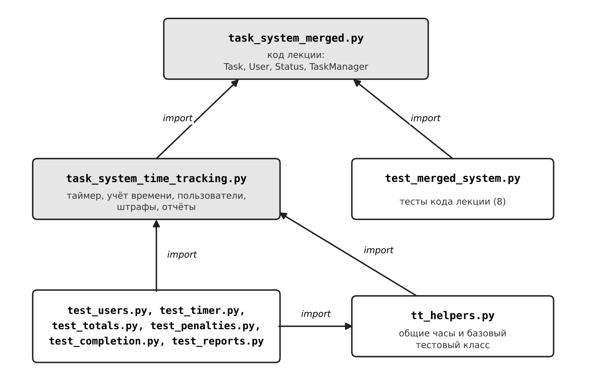

# Модуль учёта времени для системы управления задачами

Практическое задание к лекции №5 «Этапы разработки программного продукта» по дисциплине
«Проектирование и разработка бизнес-ориентированного программного обеспечения».
Выполнила: Миньковская Ксения Максимовна, группа Б1123-38.03.05ба(2), ДВФУ, ШЭМ.

## Введение

Актуальность темы определяется тем, что точный учёт времени лежит в основе управления проектами: по затраченному времени
оценивают трудозатраты, планируют сроки и находят задачи, на которые уходит больше времени, чем рассчитывали. При ручном
учёте данные неточны, а о просрочках становится известно поздно. Таймер, встроенный в систему задач, фиксирует время
автоматически, а система штрафов помогает контролировать сроки и дисциплину учёта.

**Цель работы** – разработать модуль учёта времени для системы управления задачами из лекции №5.

**Задачи:** собрать код лекции в один файл; реализовать таймер, учёт времени и отчёты; добавить пользователей и систему штрафов;
покрыть модуль тестами и описать структуру работы.

**Объект исследования** – система управления задачами, **предмет** – учёт времени работы над задачами.
Модуль написан на Python 3 (только стандартная библиотека), тесты – на `unittest`.

**Методы исследования** – анализ задания и кода лекции, объектно-ориентированное проектирование, программирование на Python и модульное тестирование.

**Структура работы.** Работа состоит из введения, двух разделов, заключения и списка использованных источников. В первом разделе описаны файлы проекта, их взаимодействие и классы модуля, во втором – реализация требований задания, система штрафов, тестирование и запуск.

## 1 Структура проекта

### 1.1 Файлы проекта

Проект состоит из двух файлов с кодом и набора файлов с тестами.

```
├── task_system_merged.py          # 1-й файл: объединённый код лекции
├── task_system_time_tracking.py   # 2-й файл: переработанная версия с учётом времени
├── tt_helpers.py                  # общие помощники для тестов (часы, базовый класс)
├── test_merged_system.py          # тесты кода лекции
├── test_users.py                  # тесты пользователей
├── test_timer.py                  # тесты таймера
├── test_totals.py                 # тесты учёта времени
├── test_penalties.py              # тесты штрафов
├── test_completion.py             # тесты завершения задачи
├── test_reports.py                # тесты отчётов
├── structure.png                  # схема взаимодействия файлов
└── README.md                      # это описание
```

| Файл | Назначение |
|---|---|
| `task_system_merged.py` | Объединяющий файл: весь код лекции (задачи, пользователи, менеджер, мониторинг, канбан) в одном модуле |
| `task_system_time_tracking.py` | Переработанная версия: таймер, учёт времени, пользователи, штрафы, отчёты |
| `test_*.py` (7 файлов) | Тесты по группам проверок: пользователи, таймер, время, штрафы, завершение, отчёты, код лекции |
| `tt_helpers.py` | Общие помощники для тестов: управляемые часы, базовый класс |

Файлы взаимодействуют через импорт (рисунок 1): второй файл подключает классы лекции из первого, поэтому модуль встроен
в существующую систему задач, а тесты подключают проверяемый код и общие часы из `tt_helpers.py`.



*Рисунок 1 – Взаимодействие файлов проекта*

### 1.2 Классы модуля учёта времени

Ядро модуля – класс `TimeTracker` (таймеры, подсчёт времени, штрафы, отчёты). `TimedTaskManager` наследует `TaskManager` из
лекции и добавляет таймеры и проверку пользователей. Остальные классы: `TimeEntry` (рабочая сессия), `PenaltyPolicy` и
`PenaltyLedger` (правила и журнал штрафов). Длительности хранятся в типе `timedelta`, а время задаётся функцией часов,
поэтому в тестах оно управляемое.

## 2 Реализация и тестирование

### 2.1 Соответствие требованиям задания

| Требование | Реализация |
|---|---|
| Старт и остановка таймера | `start_timer`, `stop_timer` |
| Учёт общего времени | `total_time` (по задаче), `user_time` (по пользователю) |
| Отчёты по времени | `generate_time_report` (с фильтром по периоду), `format_report_text` |
| Интеграция с системой задач | `TimedTaskManager` расширяет `TaskManager`; отчёт задач дополнен разделом времени |
| Пользователи | `create_user`: имя не пустое, e-mail корректный и уникальный |
| Система штрафов | `PenaltyPolicy`, `PenaltyLedger`, `evaluate_completion` |

Каждое требование реализовано отдельным методом, пользователи и штрафы добавлены по указанию преподавателя.
Таймер запускается только на свою задачу, у пользователя может быть один запущенный таймер, на завершённой задаче таймер не
запускается, а забытый (дольше 8 часов) останавливается автоматически.

### 2.2 Система штрафов

| Причина | Условие | Баллы |
|---|---|---|
| Просрочка | Задача закрыта после срока | 10 + 5 за полные сутки |
| Забытый таймер | Сессия дольше 8 часов | 5 |
| Превышение оценки | Время больше оценки более чем на 20 % | 3 |

Значения настраиваются в `PenaltyPolicy`, штрафы записываются в журнал и выводятся в отчёте.

### 2.3 Тестирование и запуск

Написаны 53 теста на `unittest`, все они проходят.

| Файл | Что проверяет | Тестов |
|---|---|---|
| `test_merged_system.py` | код лекции | 8 |
| `test_users.py` | создание пользователя, пустое имя, e-mail, дубликаты | 4 |
| `test_timer.py` | старт и остановка, один таймер на пользователя, чужая и закрытая задача | 8 |
| `test_totals.py` | сумма по сессиям, идущий таймер, время пользователя | 6 |
| `test_penalties.py` | просрочка, забытый таймер, превышение оценки, настройка политики | 14 |
| `test_completion.py` | завершение задачи останавливает таймеры | 4 |
| `test_reports.py` | структура отчёта, период, штрафы, текстовый вид | 9 |

Запуск:

```
python task_system_time_tracking.py       # демонстрация: отчёт по времени со штрафами
python -m unittest discover -v            # все тесты
python -m unittest test_penalties -v      # тесты одного файла
```

## Заключение

Цель работы – разработать модуль учёта времени для системы управления задачами из лекции №5 – достигнута: модуль создан, встроен в систему задач и проверен тестами.

Поставленные задачи решены. Код лекции собран в один рабочий файл `task_system_merged.py`, в нём исправлены места, из-за которых он не запускался. В файле `task_system_time_tracking.py` реализованы запуск и остановка таймера, учёт общего времени по задачам и пользователям и отчёты по времени с фильтром по периоду (раздел 2). Добавлены пользователи с проверкой имени и уникальности e-mail и система штрафов за просрочку, забытый таймер и превышение оценки времени (подраздел 2.2). Модуль покрыт 53 тестами, которые разнесены по отдельным файлам; структура проекта и взаимодействие файлов описаны в разделе 1.

Объект исследования – система управления задачами, предмет – учёт времени работы над задачами – рассмотрены полностью. Актуальность подтверждается практической пользой модуля: автоматический таймер даёт точные данные о трудозатратах, а штрафы помогают контролировать сроки. Код размещён в репозитории GitHub, что позволяет проверить и развивать работу.
